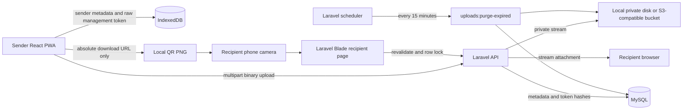

# Architecture

## System view

## Trust boundaries

The browser-provided filename, extension, and MIME type are untrusted. Laravel uses `fileinfo` MIME detection, an explicit image/video allowlist, a random ULID storage filename, size validation, and a streaming SHA-256 digest. HTML, SVG, script, executable, and archive MIME types are absent from the allowlist.

The public download token and private management token are independent 32-byte random values. The download token appears only in the recipient URL. The management token is returned only once to the sender and later travels only in `X-Management-Token`. MySQL contains only `SHA-256(token)` values.

## Upload transaction

1. Laravel validates fields and detects MIME type server-side.
2. It calculates SHA-256 from the upload temporary file using `hash_file`, which streams rather than materializing the file in PHP memory.
3. Laravel Storage moves/streams the file to a random private key.
4. Metadata and hashes are inserted.
5. If database insertion fails, the newly stored file is deleted and the original error is rethrown.
6. Only after storage and metadata succeed are the raw URLs/tokens returned.

## Download concurrency

The file endpoint hashes the presented token and opens a database transaction with `SELECT ... FOR UPDATE`. Expiration, deletion, file existence, and the count limit are revalidated while holding that row lock. A GET increments and commits before streaming; a HEAD validates but does not increment. This conservative order prevents two concurrent one-download requests from both succeeding on MySQL.

SQLite feature tests verify sequential behavior. Production concurrency semantics depend on MySQL/InnoDB row locking and should be load-tested in the deployment environment.

## Storage model

The `uploads` table contains a ULID, escaped original filename metadata, disk/key, MIME, extension, byte size, SHA-256, token hashes, expiration, optional limit, count, state, purge time, and timestamps. It has unique token/path constraints and expiration/status indexes. It never contains a BLOB.

Private local files live under `backend/storage/app/private/uploads/`. The public directory contains only application assets. For S3-compatible production, Laravel's disk abstraction changes the adapter while preserving the metadata contract.

## Frontend memory model

Files are passed to Axios as multipart `File` objects. Images/videos are previewed through revocable object URLs; video uses `preload="metadata"`. Camera canvas capture creates a JPEG `Blob`/`File`. No upload path converts file bytes to Base64. The only Base64 data URL is the small locally generated QR PNG.

IndexedDB stores sender metadata and the management token, never file contents. Clearing site data intentionally destroys local management access.

